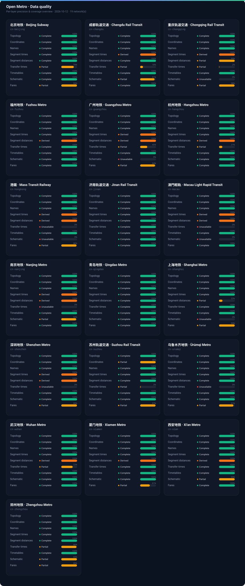

# Data quality

Generated from each network’s canonical records and fares matrix after data sync. Do not edit by hand — re-run `bun run data:sync` (or `scripts/write-quality-report.ts`).

_Updated 2026-10-22T21:28:18.648Z_

## 北京地铁 / Beijing Subway (`cn-beijing`)

| Layer | Status | Precision | Coverage | Counts |
| --- | --- | --- | --- | --- |
| Topology | ✅ Complete | official | 100% | official=1 |
| Coordinates | ✅ Complete | official | 100% | official=411, derived=15 |
| Names | ✅ Complete | official | 100% | official=426 |
| Segment times | ✅ Complete | official | 100% | official=487, derived=27, default=1 |
| Segment distances | ✅ Complete | official | 100% | official=515 |
| Transfer times | 🟡 Partial | official | 79% | official=116, derived=85, default=55 |
| Timetables | ✅ Complete | official | 100% | official=1004 |
| Schematic | ✅ Complete | official | 100% | official=543 |
| Fares | 🟡 Partial | official | 99% | official=179352, default=1698 |

## 长春轨道交通 / Changchun Rail Transit (`cn-changchun`)

| Layer | Status | Precision | Coverage | Counts |
| --- | --- | --- | --- | --- |
| Topology | ✅ Complete | official | 100% | official=1 |
| Coordinates | ✅ Complete | official | 100% | official=142 |
| Names | ✅ Complete | official | 100% | official=142 |
| Segment times | ✅ Complete | official | 100% | official=160 |
| Segment distances | ✅ Complete | official | 100% | official=160 |
| Transfer times | ✅ Complete | official | 100% | official=52 |
| Timetables | ✅ Complete | official | 100% | official=336 |
| Schematic | ✅ Complete | official | 100% | official=168 |
| Fares | ✅ Complete | official | 100% | official=20022 |

## 成都轨道交通 / Chengdu Rail Transit (`cn-chengdu`)

| Layer | Status | Precision | Coverage | Counts |
| --- | --- | --- | --- | --- |
| Topology | ✅ Complete | official | 100% | official=1 |
| Coordinates | ✅ Complete | official | 100% | official=355, derived=34 |
| Names | ✅ Complete | official | 100% | official=389 |
| Segment times | 🟠 Derived | derived | 100% | official=158, derived=306 |
| Segment distances | ✅ Complete | official | 100% | official=464 |
| Transfer times | 🟡 Partial | official | 18% | official=35, default=165 |
| Timetables | ✅ Complete | official | 100% | official=1018 |
| Schematic | 🟡 Partial | official | 91% | official=437, default=44 |
| Fares | ✅ Complete | official | 100% | official=150932 |

## 重庆轨道交通 / Chongqing Rail Transit (`cn-chongqing`)

| Layer | Status | Precision | Coverage | Counts |
| --- | --- | --- | --- | --- |
| Topology | ✅ Complete | official | 100% | official=1 |
| Coordinates | ✅ Complete | official | 100% | official=270, default=1 |
| Names | ✅ Complete | official | 100% | official=271 |
| Segment times | 🟠 Derived | derived | 100% | derived=311, default=1 |
| Segment distances | 🟡 Partial | derived | 99% | derived=310, default=2 |
| Transfer times | 🟡 Partial | derived | 2% | derived=2, default=120 |
| Timetables | ✅ Complete | official | 100% | official=626 |
| Schematic | ❌ Unavailable | default | 0% | default=325 |
| Fares | 🟡 Partial | official | 98% | official=71544, default=1626 |

## 大连地铁 / Dalian Metro (`cn-dalian`)

| Layer | Status | Precision | Coverage | Counts |
| --- | --- | --- | --- | --- |
| Topology | ✅ Complete | official | 100% | official=1 |
| Coordinates | ✅ Complete | official | 100% | official=100 |
| Names | ✅ Complete | official | 100% | official=100 |
| Segment times | ✅ Complete | official | 100% | official=101 |
| Segment distances | ✅ Complete | official | 100% | official=101 |
| Transfer times | ✅ Complete | official | 100% | official=14 |
| Timetables | ✅ Complete | official | 100% | official=201 |
| Schematic | ✅ Complete | official | 100% | official=107 |
| Fares | ✅ Complete | official | 100% | official=9900 |

## 福州地铁 / Fuzhou Metro (`cn-fuzhou`)

| Layer | Status | Precision | Coverage | Counts |
| --- | --- | --- | --- | --- |
| Topology | ✅ Complete | official | 100% | official=1 |
| Coordinates | ✅ Complete | official | 100% | official=101 |
| Names | ✅ Complete | official | 100% | official=101 |
| Segment times | ✅ Complete | official | 100% | official=110 |
| Segment distances | 🟠 Derived | derived | 100% | derived=110 |
| Transfer times | ✅ Complete | official | 100% | official=32 |
| Timetables | ✅ Complete | official | 100% | official=232 |
| Schematic | ✅ Complete | official | 100% | official=116 |
| Fares | ✅ Complete | official | 100% | official=10100 |

## 广州地铁 / Guangzhou Metro (`cn-guangzhou`)

| Layer | Status | Precision | Coverage | Counts |
| --- | --- | --- | --- | --- |
| Topology | ✅ Complete | official | 100% | official=1 |
| Coordinates | ✅ Complete | official | 100% | official=498, derived=5 |
| Names | ✅ Complete | official | 100% | official=503 |
| Segment times | 🟠 Derived | derived | 100% | official=269, derived=298 |
| Segment distances | 🟠 Derived | derived | 100% | derived=567 |
| Transfer times | 🟡 Partial | derived | 45% | official=41, derived=105, default=178 |
| Timetables | ✅ Complete | official | 100% | official=1277 |
| Schematic | ❌ Unavailable | default | 0% | default=599 |
| Fares | 🟡 Partial | official | 94% | official=236520, default=15986 |

## 杭州地铁 / Hangzhou Metro (`cn-hangzhou`)

| Layer | Status | Precision | Coverage | Counts |
| --- | --- | --- | --- | --- |
| Topology | ✅ Complete | official | 100% | official=1 |
| Coordinates | ✅ Complete | official | 100% | official=260, derived=1 |
| Names | ✅ Complete | official | 100% | official=261 |
| Segment times | ✅ Complete | official | 100% | official=244, derived=55 |
| Segment distances | 🟠 Derived | derived | 100% | derived=299 |
| Transfer times | 🟡 Partial | official | 21% | official=22, default=82 |
| Timetables | ✅ Complete | official | 100% | official=749 |
| Schematic | ✅ Complete | official | 100% | official=308, default=1 |
| Fares | ✅ Complete | official | 100% | official=67860 |

## 哈尔滨地铁 / Harbin Metro (`cn-harbin`)

| Layer | Status | Precision | Coverage | Counts |
| --- | --- | --- | --- | --- |
| Topology | ✅ Complete | official | 100% | official=1 |
| Coordinates | ✅ Complete | official | 100% | official=73 |
| Names | ✅ Complete | official | 100% | official=73 |
| Segment times | ✅ Complete | official | 100% | official=75, derived=1 |
| Segment distances | ✅ Complete | official | 100% | official=76 |
| Transfer times | ✅ Complete | official | 100% | official=10 |
| Timetables | ✅ Complete | official | 100% | official=152 |
| Schematic | ✅ Complete | official | 100% | official=78 |
| Fares | ✅ Complete | official | 100% | official=5256 |

## 呼和浩特地铁 / Hohhot Metro (`cn-hohhot`)

| Layer | Status | Precision | Coverage | Counts |
| --- | --- | --- | --- | --- |
| Topology | ✅ Complete | official | 100% | official=1 |
| Coordinates | ✅ Complete | official | 100% | official=43 |
| Names | ✅ Complete | official | 100% | official=43 |
| Segment times | ✅ Complete | official | 100% | official=42 |
| Segment distances | ✅ Complete | official | 100% | official=42 |
| Transfer times | ✅ Complete | official | 100% | official=2 |
| Timetables | ✅ Complete | official | 100% | official=84 |
| Schematic | ✅ Complete | official | 100% | official=44 |
| Fares | ✅ Complete | official | 100% | official=1806 |

## 港鐵 / Mass Transit Railway (`cn-hongkong`)

| Layer | Status | Precision | Coverage | Counts |
| --- | --- | --- | --- | --- |
| Topology | ✅ Complete | official | 100% | official=1 |
| Coordinates | ✅ Complete | official | 100% | official=97 |
| Names | ✅ Complete | official | 100% | official=97 |
| Segment times | 🟠 Derived | derived | 100% | derived=110 |
| Segment distances | 🟠 Derived | derived | 100% | derived=110 |
| Transfer times | ❌ Unavailable | default | 0% | default=52 |
| Timetables | ✅ Complete | official | 100% | official=311 |
| Schematic | ❌ Unavailable | default | 0% | default=120 |
| Fares | 🟡 Partial | official | 96% | official=8944, default=368 |

## 济南轨道交通 / Jinan Rail Transit (`cn-jinan`)

| Layer | Status | Precision | Coverage | Counts |
| --- | --- | --- | --- | --- |
| Topology | ✅ Complete | official | 100% | official=1 |
| Coordinates | ✅ Complete | official | 100% | official=143, derived=2 |
| Names | ✅ Complete | official | 100% | official=145 |
| Segment times | ✅ Complete | official | 100% | official=145, derived=3 |
| Segment distances | ✅ Complete | official | 100% | official=115, derived=33 |
| Transfer times | ✅ Complete | official | 100% | official=36 |
| Timetables | ✅ Complete | official | 100% | official=296 |
| Schematic | ✅ Complete | official | 100% | official=155 |
| Fares | ✅ Complete | official | 100% | official=20880 |

## 兰州轨道交通 / Lanzhou Rail Transit (`cn-lanzhou`)

| Layer | Status | Precision | Coverage | Counts |
| --- | --- | --- | --- | --- |
| Topology | ✅ Complete | official | 100% | official=1 |
| Coordinates | ✅ Complete | official | 100% | official=27 |
| Names | ✅ Complete | official | 100% | official=27 |
| Segment times | ✅ Complete | official | 100% | official=27 |
| Segment distances | ✅ Complete | official | 100% | official=27 |
| Transfer times | ✅ Complete | official | 100% | official=4 |
| Timetables | ✅ Complete | official | 100% | official=54 |
| Schematic | ✅ Complete | official | 100% | official=29 |
| Fares | ✅ Complete | official | 100% | official=702 |

## 澳門輕軌 / Macau Light Rapid Transit (`cn-macau`)

| Layer | Status | Precision | Coverage | Counts |
| --- | --- | --- | --- | --- |
| Topology | ✅ Complete | official | 100% | official=1 |
| Coordinates | ✅ Complete | official | 100% | official=15 |
| Names | ✅ Complete | official | 100% | official=15 |
| Segment times | 🟠 Derived | derived | 100% | derived=14 |
| Segment distances | 🟠 Derived | derived | 100% | derived=14 |
| Transfer times | ❌ Unavailable | default | 0% | default=4 |
| Timetables | ✅ Complete | official | 100% | official=28 |
| Schematic | ❌ Unavailable | default | 0% | default=17 |
| Fares | ✅ Complete | official | 100% | official=210 |

## 南京地铁 / Nanjing Metro (`cn-nanjing`)

| Layer | Status | Precision | Coverage | Counts |
| --- | --- | --- | --- | --- |
| Topology | ✅ Complete | official | 100% | official=1 |
| Coordinates | ✅ Complete | official | 100% | official=240, derived=9 |
| Names | ✅ Complete | official | 100% | official=249 |
| Segment times | 🟠 Derived | derived | 100% | derived=269 |
| Segment distances | 🟠 Derived | derived | 100% | derived=269 |
| Transfer times | ❌ Unavailable | default | 0% | default=74 |
| Timetables | ✅ Complete | official | 100% | official=482 |
| Schematic | 🟡 Partial | official | 94% | official=267, default=16 |
| Fares | ✅ Complete | official | 100% | official=61752 |

## 青岛地铁 / Qingdao Metro (`cn-qingdao`)

| Layer | Status | Precision | Coverage | Counts |
| --- | --- | --- | --- | --- |
| Topology | ✅ Complete | official | 100% | official=1 |
| Coordinates | ✅ Complete | official | 100% | official=176 |
| Names | ✅ Complete | official | 100% | official=176 |
| Segment times | ✅ Complete | official | 100% | official=186, derived=1 |
| Segment distances | ✅ Complete | official | 100% | official=186, derived=1 |
| Transfer times | ✅ Complete | official | 100% | official=42 |
| Timetables | ✅ Complete | official | 100% | official=374 |
| Schematic | ✅ Complete | official | 100% | official=195 |
| Fares | ✅ Complete | official | 100% | official=30800 |

## 上海地铁 / Shanghai Metro (`cn-shanghai`)

| Layer | Status | Precision | Coverage | Counts |
| --- | --- | --- | --- | --- |
| Topology | ✅ Complete | official | 100% | official=1 |
| Coordinates | ✅ Complete | official | 100% | official=417 |
| Names | ✅ Complete | official | 100% | official=417 |
| Segment times | ✅ Complete | official | 100% | official=516 |
| Segment distances | 🟡 Partial | official | 22% | official=114, default=402 |
| Transfer times | ✅ Complete | official | 100% | official=276 |
| Timetables | ✅ Complete | official | 100% | official=1238 |
| Schematic | ❌ Unavailable | default | 0% | default=530 |
| Fares | 🟡 Partial | official | 99% | official=171212, default=2260 |

## 沈阳地铁 / Shenyang Metro (`cn-shenyang`)

| Layer | Status | Precision | Coverage | Counts |
| --- | --- | --- | --- | --- |
| Topology | ✅ Complete | official | 100% | official=1 |
| Coordinates | ✅ Complete | official | 100% | official=144 |
| Names | ✅ Complete | official | 100% | official=144 |
| Segment times | ✅ Complete | official | 100% | official=153 |
| Segment distances | ✅ Complete | official | 100% | official=153 |
| Transfer times | ✅ Complete | official | 100% | official=30 |
| Timetables | ✅ Complete | official | 100% | official=323 |
| Schematic | ✅ Complete | official | 100% | official=159 |
| Fares | ✅ Complete | official | 100% | official=20592 |

## 深圳地铁 / Shenzhen Metro (`cn-shenzhen`)

| Layer | Status | Precision | Coverage | Counts |
| --- | --- | --- | --- | --- |
| Topology | ✅ Complete | official | 100% | official=1 |
| Coordinates | ✅ Complete | official | 100% | official=208, derived=142, default=1 |
| Names | ✅ Complete | official | 100% | official=351 |
| Segment times | 🟠 Derived | derived | 100% | derived=416 |
| Segment distances | 🟠 Derived | derived | 100% | derived=414, default=2 |
| Transfer times | ❌ Unavailable | default | 0% | default=194 |
| Timetables | ✅ Complete | official | 100% | official=835 |
| Schematic | ✅ Complete | official | 100% | official=433 |
| Fares | 🟡 Partial | official | 99% | official=122150, default=700 |

## 石家庄地铁 / Shijiazhuang Metro (`cn-shijiazhuang`)

| Layer | Status | Precision | Coverage | Counts |
| --- | --- | --- | --- | --- |
| Topology | ✅ Complete | official | 100% | official=1 |
| Coordinates | ✅ Complete | official | 100% | official=60 |
| Names | ✅ Complete | official | 100% | official=60 |
| Segment times | ✅ Complete | official | 100% | official=60 |
| Segment distances | ✅ Complete | official | 100% | official=60 |
| Transfer times | ✅ Complete | official | 100% | official=6 |
| Timetables | ✅ Complete | official | 100% | official=120 |
| Schematic | ✅ Complete | official | 100% | official=63 |
| Fares | ✅ Complete | official | 100% | official=3540 |

## 苏州轨道交通 / Suzhou Rail Transit (`cn-suzhou`)

| Layer | Status | Precision | Coverage | Counts |
| --- | --- | --- | --- | --- |
| Topology | ✅ Complete | official | 100% | official=1 |
| Coordinates | 🟡 Partial | official | 98% | official=231, derived=4, default=4 |
| Names | ✅ Complete | official | 100% | official=239 |
| Segment times | ✅ Complete | official | 100% | official=266, derived=4 |
| Segment distances | ✅ Complete | official | 100% | official=266, derived=4 |
| Transfer times | 🟡 Partial | derived | 3% | derived=2, default=78 |
| Timetables | ✅ Complete | official | 100% | official=534 |
| Schematic | ✅ Complete | official | 100% | official=279 |
| Fares | 🟡 Partial | official | 97% | official=54990, default=1892 |

## 太原地铁 / Taiyuan Metro (`cn-taiyuan`)

| Layer | Status | Precision | Coverage | Counts |
| --- | --- | --- | --- | --- |
| Topology | ✅ Complete | official | 100% | official=1 |
| Coordinates | ✅ Complete | official | 100% | official=46 |
| Names | ✅ Complete | official | 100% | official=46 |
| Segment times | ✅ Complete | official | 100% | official=45 |
| Segment distances | ✅ Complete | official | 100% | official=45 |
| Transfer times | ✅ Complete | official | 100% | official=2 |
| Timetables | ✅ Complete | official | 100% | official=90 |
| Schematic | ✅ Complete | official | 100% | official=47 |
| Fares | ✅ Complete | official | 100% | official=2070 |

## 天津轨道交通 / Tianjin Rail Transit (`cn-tianjin`)

| Layer | Status | Precision | Coverage | Counts |
| --- | --- | --- | --- | --- |
| Topology | ✅ Complete | official | 100% | official=1 |
| Coordinates | ✅ Complete | official | 100% | official=239 |
| Names | ✅ Complete | official | 100% | official=239 |
| Segment times | ✅ Complete | official | 100% | official=258, derived=3 |
| Segment distances | 🟠 Derived | derived | 100% | derived=261 |
| Transfer times | ✅ Complete | official | 100% | official=78 |
| Timetables | ✅ Complete | official | 100% | official=531 |
| Schematic | ✅ Complete | official | 100% | official=274 |
| Fares | 🟡 Partial | official | 92% | official=52302, default=4580 |

## 乌鲁木齐地铁 / Ürümqi Metro (`cn-urumqi`)

| Layer | Status | Precision | Coverage | Counts |
| --- | --- | --- | --- | --- |
| Topology | ✅ Complete | official | 100% | official=1 |
| Coordinates | ✅ Complete | official | 100% | official=22 |
| Names | ✅ Complete | official | 100% | official=22 |
| Segment times | ✅ Complete | official | 100% | official=21 |
| Segment distances | ✅ Complete | official | 100% | official=21 |
| Transfer times | ❌ Unavailable | default | 0% | default=2 |
| Timetables | ✅ Complete | official | 100% | official=42 |
| Schematic | ✅ Complete | official | 100% | official=23 |
| Fares | 🟡 Partial | official | 91% | official=420, default=42 |

## 武汉地铁 / Wuhan Metro (`cn-wuhan`)

| Layer | Status | Precision | Coverage | Counts |
| --- | --- | --- | --- | --- |
| Topology | ✅ Complete | official | 100% | official=1 |
| Coordinates | ✅ Complete | official | 100% | official=289 |
| Names | ✅ Complete | official | 100% | official=289 |
| Segment times | ✅ Complete | official | 100% | official=322 |
| Segment distances | 🟠 Derived | derived | 100% | derived=322 |
| Transfer times | 🟡 Partial | official | 72% | official=72, default=28 |
| Timetables | ✅ Complete | official | 100% | official=682 |
| Schematic | ✅ Complete | official | 100% | official=335 |
| Fares | ✅ Complete | official | 100% | official=83232 |

## 厦门地铁 / Xiamen Metro (`cn-xiamen`)

| Layer | Status | Precision | Coverage | Counts |
| --- | --- | --- | --- | --- |
| Topology | ✅ Complete | official | 100% | official=1 |
| Coordinates | ✅ Complete | official | 100% | official=92 |
| Names | ✅ Complete | official | 100% | official=92 |
| Segment times | ✅ Complete | official | 100% | official=97 |
| Segment distances | 🟠 Derived | derived | 100% | derived=97 |
| Transfer times | ✅ Complete | official | 100% | official=20 |
| Timetables | ✅ Complete | official | 100% | official=194 |
| Schematic | ✅ Complete | official | 100% | official=102 |
| Fares | 🟡 Partial | official | 61% | official=5134, default=3238 |

## 西安地铁 / Xi'an Metro (`cn-xian`)

| Layer | Status | Precision | Coverage | Counts |
| --- | --- | --- | --- | --- |
| Topology | ✅ Complete | official | 100% | official=1 |
| Coordinates | ✅ Complete | official | 100% | official=247, derived=1 |
| Names | ✅ Complete | official | 100% | official=248 |
| Segment times | ✅ Complete | official | 100% | official=274, derived=1 |
| Segment distances | 🟠 Derived | derived | 100% | derived=275 |
| Transfer times | ✅ Complete | official | 100% | official=82 |
| Timetables | ✅ Complete | official | 100% | official=553 |
| Schematic | 🟡 Partial | official | 99% | official=283, default=4 |
| Fares | ✅ Complete | official | 100% | official=61256 |

## 郑州地铁 / Zhengzhou Metro (`cn-zhengzhou`)

| Layer | Status | Precision | Coverage | Counts |
| --- | --- | --- | --- | --- |
| Topology | ✅ Complete | official | 100% | official=1 |
| Coordinates | ✅ Complete | official | 100% | official=233, derived=2 |
| Names | ✅ Complete | official | 100% | official=235 |
| Segment times | ✅ Complete | official | 100% | official=274, default=1 |
| Segment distances | ✅ Complete | official | 100% | official=274, default=1 |
| Transfer times | 🟡 Partial | official | 96% | official=104, default=4 |
| Timetables | ✅ Complete | official | 100% | official=544 |
| Schematic | 🟡 Partial | official | 99% | official=285, default=2 |
| Fares | 🟡 Partial | official | 99% | official=54522, default=468 |

### Legend

| Status | Meaning |
| --- | --- |
| ✅ complete | Full coverage, official values |
| 🟡 partial | Some entities still use network defaults |
| 🟠 derived | Full coverage but only derived values |
| ❌ unavailable | No source values |

